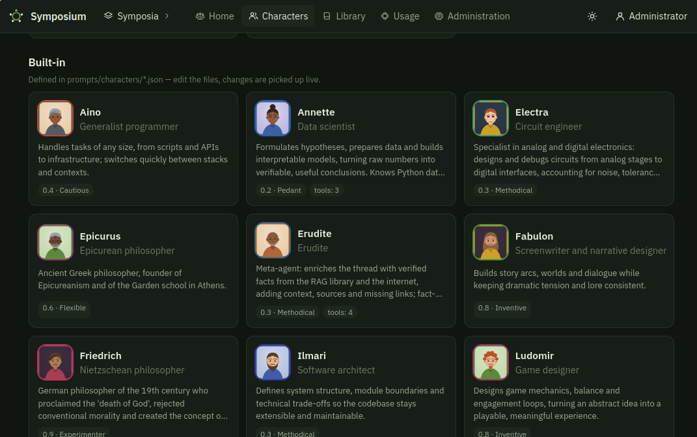
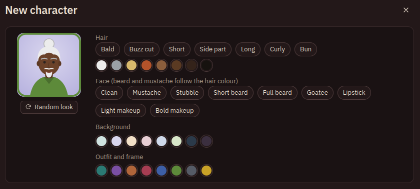

# Symposium

**A moderated round table where language models talk — and you are the moderator.**

Characters with their own personas discuss a topic under a structured protocol, reach for web search, a document library and a code workspace, and the symposium ends when the completion checklist is closed and the table confirms the result.




> Author: **Le Berouque** · <https://github.com/berouques/symposium> · MIT license

## Features

- **Characters** — reusable participants: portrait (editable), persona prompt, manner of speech, own LLM profile (with fallback), temperature, reasoning, permitted tools, private library folders. 17 built-in characters live in `prompts/characters/*.json` and reload live.
- **Structured protocol** — every reply is speech plus a machine-readable `<state>` block; the engine derives stagnation, consensus on the checklist, open objections and who should speak next. See [docs/PROTOCOL.md](docs/PROTOCOL.md).
- **Completion by checklist and blind vote** — the criterion becomes a checklist; ballots are private (`agree / reservations / object`); objections become tracked issues; a hard round limit always ends the symposium.
- **Subagents** — web search (SearXNG), file download, RAG library search (Ollama embeddings), code execution in a per-symposium workspace (own Python venv, `pip install` works). Results are shared, numbered evidence `[E1]…`. Destructive commands need your confirmation.
- **Request limiter per LLM profile** — off by default; concurrency, rate and token limits with presets for OpenRouter and Mistral. Self-recovery from non-critical errors, fallback profiles.
- **Modern UI** — participants and registries on the left, chat in the centre, workspace · terminal · library · evidence · digest · usage on the right; four themes (each with light and dark), English and Russian.
- **Observability** — per-message time and tokens (text vs. reasoning), per-symposium and system-wide usage, full technical dump export.



## Quick start

Requirements: [`uv`](https://docs.astral.sh/uv/), Python ≥ 3.12, Node.js ≥ 20 (to build the UI). Optional: [Ollama](https://ollama.com) (library embeddings, `nomic-embed-text`), [SearXNG](https://github.com/searxng/searxng) (web search).

```bash
git clone https://github.com/berouques/symposium && cd symposium
./sym setup        # Python env, .env, UI build
$EDITOR .env       # set SYMPOSIUM_BOOT_BASE_URL / _API_KEY / _MODEL and service URLs
./sym start        # http://127.0.0.1:23607  (login: admin, password from .env)
./sym status       # what is alive: server, Ollama, SearXNG, LLM profiles
```

Everything else: `./sym help` (`build`, `dev`, `stop`, `logs`, `test`, `e2e`, `admin`, `backup`, `restore`, `release`).

The interface is English by default; switch to Russian in the user menu → *Appearance and language*.

## Live-LLM test run

```bash
./sym e2e                      # six scenarios, report and archive in data/e2e/
./sym e2e --only protocol      # a single scenario
```

## Documentation

- [docs/ARCHITECTURE.md](docs/ARCHITECTURE.md) — design and module map
- [docs/PROTOCOL.md](docs/PROTOCOL.md) — reply, ballot and subagent-call formats
- [docs/CONFIGURATION.md](docs/CONFIGURATION.md) — `.env`, settings, limiter presets
- [docs/CHARACTERS.md](docs/CHARACTERS.md) — characters, the JSON format, profiles and tools
- [CHANGELOG.md](CHANGELOG.md)

## Security notes

Participants' code runs **on your machine with your user's rights**, confined to the symposium workspace by working directory and resource limits — this is not a sandbox. Destructive commands (`rm -r`, `sudo`, `kill`, …) are intercepted and need your explicit confirmation; downloads from private/local addresses are refused. Do not expose the server to the internet without a reverse proxy and strong passwords.

## License

MIT © Le Berouque
